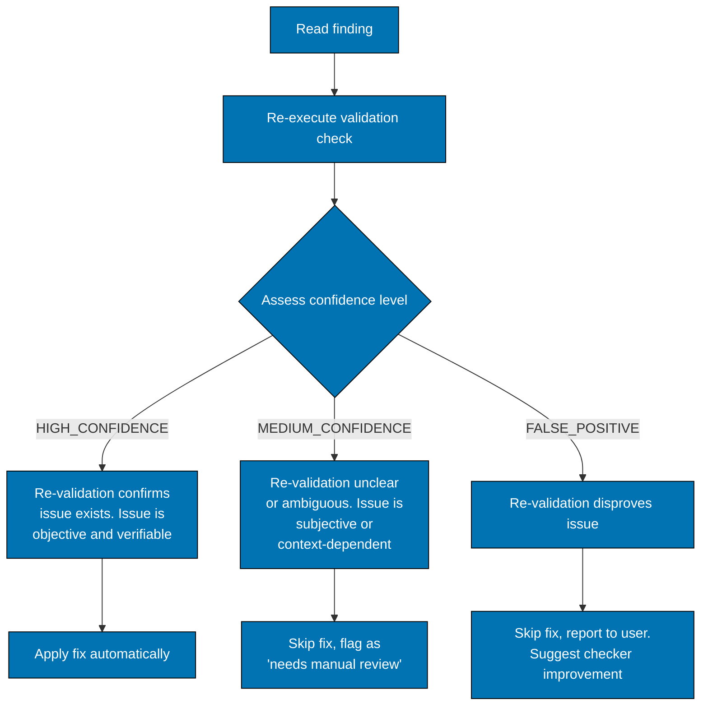

# Maker-Checker-Fixer Pattern (Comprehensive): Part 3 of 7

### Stage 3: Fixer (Remediation) - Detailed Workflow

**Role**: Applies validated fixes from checker audit reports

**Characteristics**:

- Validation-driven (works from audit reports, not user requests)
- Re-validation before fixing (confirms issues still exist)
- Confidence-based (only applies HIGH confidence fixes automatically)
- Safe application (skips MEDIUM and FALSE_POSITIVE)
- Audit trail (generates fix reports for transparency)

**Tool Pattern**: `Read`, `Edit`, `Glob`, `Grep`, `Write`, `Bash`

- `Edit` for applying fixes (NOT `Write`)
- `Write` for fix report generation
- `Bash` for timestamps

**Color**: Yellow (fixer agents)

**When to Use Fixer**:

- Checker has generated an audit report
- Issues are convention violations (not content gaps)
- Fixes are mechanical (field values, formatting)
- Validation-driven workflow

**When to SKIP Fixer (Manual Preferred)**:

- Issues require human judgment (narrative quality)
- Fixes are context-dependent
- Checker reports unclear/ambiguous
- User prefers manual control

**Priority-Based Execution**:

Fixers combine criticality (importance) × confidence (certainty) → priority:

| Priority         | Combination                      | Action                               |
| ---------------- | -------------------------------- | ------------------------------------ |
| **P0** (Blocker) | CRITICAL + HIGH                  | Auto-fix immediately, block if fails |
| **P1** (Urgent)  | HIGH + HIGH OR CRITICAL + MEDIUM | Auto-fix or urgent review            |
| **P2** (Normal)  | MEDIUM + HIGH OR HIGH + MEDIUM   | Auto-fix (if approved) or review     |
| **P3-P4** (Low)  | LOW combinations                 | Suggestions only                     |

**Execution Order**: P0 → P1 → P2 → P3-P4

#### Fixer Workflow: 6-Step Process

### 1. Report Discovery

**Auto-detect with manual override (default pattern)**:

```bash
# Auto-detect latest audit report for agent family
ls -t generated-reports/{agent-family}-*-audit.md | head -1
```

**Implementation Steps**:

1. **Auto-detect latest**: Find most recent audit report in `generated-reports/`
2. **Allow manual override**: Accept explicit report path from user
3. **Verify report exists**: Check file exists before proceeding
4. **Parse report format**: Extract UUID chain and timestamp for fix report

### 2. Validation Strategy

**CRITICAL PRINCIPLE**: NEVER trust checker findings blindly. ALWAYS re-validate before applying fixes.

**For EACH finding in audit report**:

The fixer reads a finding, re-executes the validation check, assesses confidence, and then applies the fix
(HIGH_CONFIDENCE), skips it and flags it for manual review (MEDIUM_CONFIDENCE), or skips it, reports it to the user, and
suggests a checker improvement (FALSE_POSITIVE).



### 3. Mode Parameter Handling

Support `mode` parameter for quality-gate workflows (default `normal`), per the
[Quality Gate Contract](../../../repo-governance/development/workflow/quality-gate-contract.md):

**Mode Levels**:

- **lax**: Process CRITICAL findings only (skip HIGH/MEDIUM/LOW)
- **normal**: Process CRITICAL + HIGH findings only (skip MEDIUM/LOW)
- **strict**: Process CRITICAL + HIGH + MEDIUM findings (skip LOW)
- **all**: Process all findings (CRITICAL + HIGH + MEDIUM + LOW)
