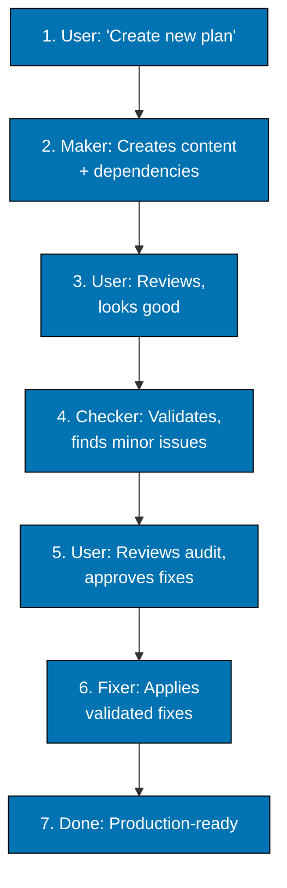
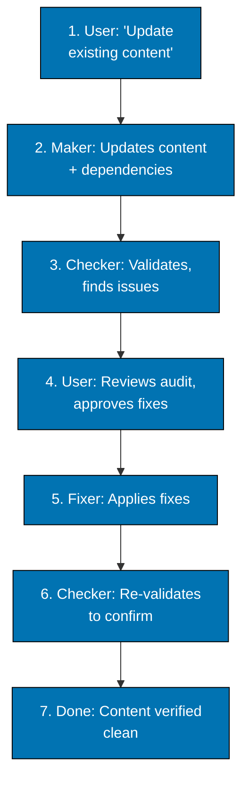

# Maker-Checker-Fixer Pattern (Comprehensive): Part 4 of 7

### 4. Fix Application

**Automatic Application** (HIGH confidence only):

- Apply ALL HIGH_CONFIDENCE fixes automatically
- NO confirmation prompts (user already reviewed checker report)
- Skip MEDIUM_CONFIDENCE findings (flag for manual review)
- Skip FALSE_POSITIVE findings (report to improve checker)
- Use the right tool for the edit shape:
  - Single-file targeted edits: `Edit` tool
  - Bulk mechanical substitutions across many files: `Bash` with `sed` / `awk`
  - New file creation: `Write` tool

### 5. Fix Report Generation

Generate fix report in `generated-reports/` using same UUID chain as audit:

**File Naming Pattern**:

- Input audit: `{agent-family}__{uuid-chain}__{timestamp}__audit.md`
- Output fix: `{agent-family}__{uuid-chain}__{timestamp}__fix.md`
- Preserve UUID chain and timestamp from source audit

### 6. Trust Model: Checker Verifies, Fixer Applies

**Key Principle**: Fixer trusts checker's verification work (separation of concerns).

**How Fixer Re-validates Without Extensive Web Access**:

- Read audit report and extract checker's documented sources
- Analyze checker's cited URLs, registry data, API docs
- Apply pattern matching for known error types
- Perform file-based checks (syntax, format, consistency)
- Conservative approach: When in doubt → MEDIUM confidence

## Common Workflows

### Basic: Create → Validate → Fix

The user asks for a new plan, the maker creates content and dependencies, the user reviews it, the checker validates and
finds minor issues, the user reviews the audit and approves fixes, and the fixer applies validated fixes, leaving the
content production-ready.

### Iterative: Maker → Checker → Fixer → Checker

The user asks to update existing content, the maker updates content and dependencies, the checker finds issues, the user
reviews the audit and approves fixes, the fixer applies them, and the checker re-validates to confirm the content is
verified clean.

**When to use**: Critical content, major refactoring, uncertain fixer confidence

## Agent Families Using This Pattern

Key families in this repository:

1. **plan-\*** - Plan completeness and structure
2. **document-\*** - Documentation quality
3. **swe-code-\*** - Code in named projects, including the workstation playbooks

Each family has:

- **Maker** (Blue) - Creates/updates content
- **Checker** (Green) - Validates, generates audits
- **Fixer** (Yellow) - Applies validated fixes
