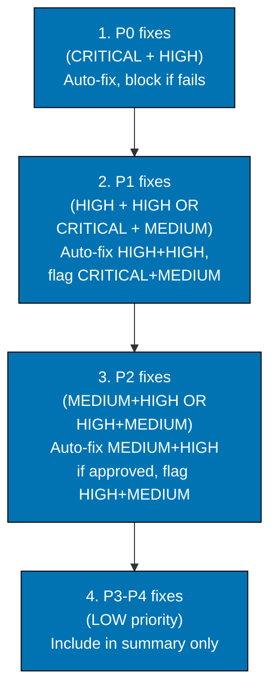

# Criticality-Confidence System Skill: Part 2 of 6

## Criticality × Confidence Priority Matrix

### Decision Matrix

Each criticality level, with its priority and action at each confidence level:

- **CRITICAL**
  - HIGH Confidence: **P0** - Auto-fix immediately (block deployment)
  - MEDIUM Confidence: **P1** - URGENT manual review
  - FALSE_POSITIVE: Report with CRITICAL context (fix urgently)
- **HIGH**
  - HIGH Confidence: **P1** - Auto-fix after P0
  - MEDIUM Confidence: **P2** - Standard manual review
  - FALSE_POSITIVE: Report with HIGH context (fix soon)
- **MEDIUM**
  - HIGH Confidence: **P2** - Auto-fix after P1 (user approval)
  - MEDIUM Confidence: **P3** - Optional review
  - FALSE_POSITIVE: Report with MEDIUM context (note for improvement)
- **LOW**
  - HIGH Confidence: **P3** - Batch fixes (user decides when)
  - MEDIUM Confidence: **P4** - Suggestions only
  - FALSE_POSITIVE: Report with LOW context (informational)

### Priority Levels Explained

- **P0** (Blocker): MUST fix before any publication/deployment
- **P1** (Urgent): SHOULD fix before publication, can proceed with approval
- **P2** (Normal): Fix in current cycle when convenient
- **P3** (Low): Fix in future cycle or batch operation
- **P4** (Optional): Suggestion only, no action required

### Execution Order for Fixers

Fixer agents MUST process findings in strict priority order:

The diagram shows fixers running P0 first (CRITICAL criticality with HIGH confidence, auto-fixed and blocking if a fix
fails), then P1 and P2, and finally P3-P4 low-priority findings, which only appear in the summary.

