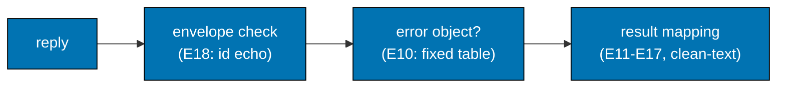

# Threat model delta for the Kiwi extensions

This page extends the [threat model delta of ADR 002](../002-spec-language-extensions/001-threat-model-delta.md) for
[ADR 003](../003-kiwi-gaps.md). It lists only what changes. Assets A1 to A6 and boundaries B1 to B5 stand as they are.
Everything on this page is planned.

## Assets

No new asset. The bundled `kiwi.yml` joins A6, the bundled specs, once pull request 31 lands. It is trusted only as
compiled-in bytes, like the other bundled specs.

## Trust boundaries

B2u and B2e stand as they are. E10 to E18 and `clean-text` are usable in a user spec, so they are untrusted input on
the B2u road, like E1 to E8. The fixed tables behind E10 (the code and word table) and `clean-text` (the strip set)
live in the engine and are reviewed once; no spec field changes them.

## Entry points that change

1. The new spec fields of E10 to E18 in a user spec.
2. The request envelope: a fixed JSON-RPC body with a sequential id, and the echo check on its reply.
3. The fan-out and assembly state: child calls per item, at most two levels, under one shared deadline.
4. The guard read before a write, with its own params from the write's args.
5. The pacing delay, per source, and the cleaned text that reaches the output.

## New threats

Each control and proof is on the page of its feature. A control without a proving test is not accepted, as in
ADR 001. These threats reuse S1, S3, S4, S7, R1, and L1 to L11.

| ID  | Threat                                                                     | Feature    | Extends |
| --- | -------------------------------------------------------------------------- | ---------- | ------- |
| L12 | An error object is mismapped, or its message leaks into an error.          | E10        | R1, S7  |
| L13 | A non-canonical prefixed ID is accepted, or two texts name one number.     | E11        | S7, S9  |
| L14 | A fan-out storms the source or computes without bound.                     | E12        | S3, S9  |
| L15 | An assembly loops, returns a partial record, or renders markup as trusted. | E13, E14   | S3, S9  |
| L16 | A reply URL is trusted and reaches another host.                           | E15        | S4      |
| L17 | A write runs without its guard, or the guard checks the wrong object.      | E16        | S4      |
| L18 | Pacing is evaded by parallel or unspaced calls.                            | E17        | S3      |
| L19 | A reply is accepted for the wrong call.                                    | E18        | S7      |
| L20 | Invisible text reaches the consumer, or cleaning hides evidence.           | clean-text | R1      |
| L21 | The language grows by habit until a spec is a program.                     | all        | L11     |

## Rules that follow

- A user spec never gains a bundled power. `Parse` refuses a built-in kind and `catalog_id` as before; none of E10 to
  E18 lifts that.
- A bundled spec passes the same validation and the same safeguards as a user spec. The exception stays exactly E9.
- The engine never trusts the reply: not its id (E18 checks it), not its error text (E10 never stores it), not its
  URLs (E15 never reads them).
- The feature list is a lock. The keyword test fails when the schema holds a term that no feature of ADR 002 or ADR
  003 names (L21).
