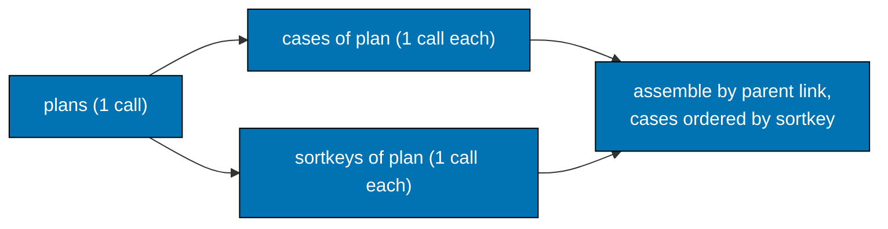

# E12: trees across requests

This page belongs to [ADR 003](../003-kiwi-gaps.md). E12 is built by pull request 29. It covers K3: `products.tree`
reads the plans of a product, then the cases and the sort-key table of each plan, and builds the tree from parent
links. E7 flattens one nested reply and can never join several.



```yaml
response:
  items: /result
  fanout:
    - { operation: kiwi.plans.by_product, param: product, from: id_number, as: plans, max_calls: 200 }
```

- **Rule.** A fan-out entry runs a read of the same spec once per item, at most two levels deep. Its parameter takes
  a constant or the item's canonical id number, never reply text. The child result attaches under `as`. A second
  entry may attach a map-shaped result, such as the sort-key table, which an `order_by` names for ordering. Parent
  links assemble the tree as `newPlanTree` does today: a plan whose parent is unknown or itself is a root, and each
  plan is listed once, so a loop of parent links cannot repeat it. Depth counts from 0 with the E7 cap of 64.
- **Limits.** At most 200 child calls per entry, and a spec may only lower it; the 201st plan is refused before any
  case is read, as the Go cap does today. All calls share the 30 second limit, the pacing of E17, the same host and
  key, and the token cap of S9. A flat loop runs the walk, never recursion.
- **L14. A fan-out storms the source or computes without bound.** Control: the call cap, the shared deadline, the
  depth cap, and the list-once rule above. Proof: `TestFanoutStopsAtMaxCalls`, `TestFanoutSharesTimeLimit`,
  `TestFanoutListsLoopedParentOnce`, `TestFanoutUnknownParentIsRoot`, `TestFanoutChildMustBeRead`, and
  `TestFanoutParamFromTextIsRefused`.
- **Cannot do.** Fan out to another spec, host, or a write. Order by text. Nest deeper than two levels. Pass a reply
  string as a parameter.
