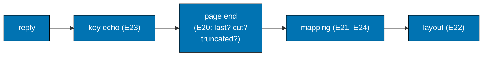

# Threat model delta for the Jira extensions

This page extends the [threat model delta of ADR 002](../002-spec-language-extensions/001-threat-model-delta.md)
and [ADR 003](../003-kiwi-gaps/001-threat-model-delta.md) for [ADR 004](../004-jira-gaps.md). It lists only what
changes. Assets A1 to A6 and boundaries B1, B3, B4, and B5 stand as they are. Everything on this page is planned.

## Assets

No new asset. The bundled `jira.yml` joins A6, the bundled specs, once pull request 37 lands. It is trusted only
as compiled-in bytes, like the other bundled specs.

## Trust boundaries

B2u and B2e stand as they are. E19 to E24 and the three converters are usable in a user spec, so they are
untrusted input on the B2u road, like E1 to E18. The fixed tables behind them (the issue-key shape, the date
layouts, the title cut, the escape set, the prefixes, and the `/browse/` path) live in the engine and are
reviewed once; no spec field changes them.

## Entry points that change

1. The new spec fields of E19 to E24 in a user spec.
2. The page-end decision: the `isLast` flag, the cut to the limit, and the computed `truncated` flag.
3. The converted text that reaches the output: timestamps, dates, titles, and built IDs.
4. The document layout: fixed lines, escaped values, defaults, and the rendered description.
5. The key echo check and the endpoint-origin URLs.

## New threats

Each control and proof is on the page of its feature. A control without a proving test is not accepted, as in
ADR 001. These threats reuse S1, S3, S4, S7, S9, and R1, and L1 to L21.

| ID  | Threat                                                                | Feature | Extends |
| --- | --------------------------------------------------------------------- | ------- | ------- |
| L22 | A bad issue key is sent, or a lowercase key is accepted.              | E19     | S7      |
| L23 | A short page is misread as last, or an over-limit reply passes whole. | E20     | S3, S9  |
| L24 | A converter hides evidence, or passes a bad value through as text.    | E21     | R1      |
| L25 | Markup in a value renders as structure, or a line leaks when empty.   | E22     | R1, S1  |
| L26 | A reply is accepted for the wrong key.                                | E23     | S7      |
| L27 | A reply URL or ID text reaches the output, or a built ID misnames.    | E24     | S4      |
| L28 | The language grows by habit until a spec is a program.                | all     | L11     |

## Rules that follow

- A user spec never gains a bundled power. `Parse` refuses a built-in kind and `catalog_id` as before; none
  of E19 to E24 lifts that.
- A bundled spec passes the same validation and the same safeguards as a user spec. The exception stays
  exactly E9.
- The engine never trusts the reply: not its key (E23 checks it), not its page flags (E20 checks their shape),
  not its dates (E21 maps a miss to empty text), and not its URLs (E24 never reads them).
- The feature list is a lock. The keyword test fails when the schema holds a term that no feature of ADR 002,
  ADR 003, or this ADR names (L28).
