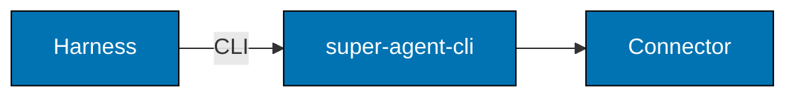

# Diagrams

Draw every conceptual diagram as a Mermaid block. Mermaid shows the relationships as a rendered figure on a host with a
renderer, and as readable source in a terminal editor. `rhino md mermaid validate` checks each block for an accessible
title and description, label length, and colours from the palette that `repo-config.yml` declares under
`policies.markdown.mermaid`.

## Which Visual Uses What

| Visual                                                            | Form                   | Mermaid type      |
| ----------------------------------------------------------------- | ---------------------- | ----------------- |
| flows and pipelines: gate surfaces, delivery workflows, data flow | Mermaid                | `flowchart`       |
| interactions over time: hook, runner, hosted job                  | Mermaid                | `sequenceDiagram` |
| states and transitions: a plan lifecycle                          | Mermaid                | `stateDiagram-v2` |
| conceptual hierarchy or ownership: repository groups, layers      | Mermaid                | `flowchart TD`    |
| data and entity relationships                                     | Mermaid                | `erDiagram`       |
| type and module relationships                                     | Mermaid                | `classDiagram`    |
| file and directory trees                                          | plain `text` block     | none              |
| command output, logs, literal code or configuration               | plain `text` block     | none              |
| terminal or screen layouts, wireframes, keymap grids              | plain `text` block     | none              |
| anything whose exact alignment or characters must be reproduced   | plain `text` block     | none              |
| exact mappings                                                    | Markdown table         | none              |
| simple sequences                                                  | prose or numbered list | none              |

The decision test: if the reader needs the relationships, use Mermaid; if the reader needs the literal characters or
layout, use a `text` block. A table and a prose list are not diagrams.

## Rules

- Use a `mermaid` fence for each conceptual diagram. Use a `text` fence for a file tree, command output, literal code or
  configuration, a name pattern, or an interface wireframe. Do not use a bare fence.
- Give each Mermaid diagram an `accTitle` and an `accDescr` line directly after its type line.
- Keep each node label segment within 32 graphemes and each edge label within 24. Split a longer node label with
  ` `.
- Set colour only in a `classDef default` line that gives `fill`, `stroke`, and `color`, using the declared palette.
  Do not use inline styles or `linkStyle`.
- Keep each line within 120 columns, the same limit as prose.
- Put a one-sentence caption above the diagram.
- Put every relationship the diagram shows in prose below it. A reader using a screen reader or a text search cannot see
  the arrows.
- Update the diagram in the same change as the structure it depicts. A stale diagram misleads more than no diagram.
- Do not draw what has not been built. Mark a planned element as planned in its label.

## Example

The caption sits above the block, and the prose below names each arrow.

The harness calls the command-line tool. The tool calls one connector for the source it names.
